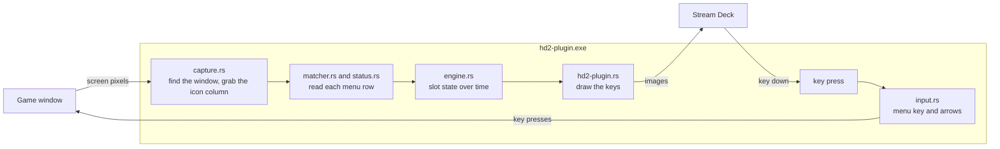

← [Documentation](README.md)

# How it works

The plugin is one Windows program, `hd2-plugin.exe`, written in Rust. Stream Deck starts it and talks to it over a local WebSocket. It reads the game the way a person would, by looking at the screen, and calls stratagems in the way a person would, by pressing keys. It never opens the game's process or reads its memory or files.



## Finding the game

Every two seconds, the plugin looks for a process named `helldivers2.exe` in a snapshot of the running processes. While there is none, it stops there: nothing is captured, and the Scan key offers to start the game through Steam.

When the game runs, the plugin finds its window by process ID and keeps the window's handle. A snapshot of every process costs milliseconds on a busy machine, so the game's process ID is reused for two seconds, and the desktop's windows are searched at most once a second while the game's window isn't known. Windows sometimes hides who owns the game's window, probably because of the game's anti-cheat (it reports process 0), and sometimes stops listing it at all. A known window that reports owner 0 is still the game's; without one, the plugin falls back, in order, to the window in front if it belongs to the game, the position where the window was last seen, and the whole main screen. Capturing needs a position on screen, not a handle to the window. The last fallback can only guess the game's size, so the *Game resolution* setting can set it by hand; the size found is shown on the Scan key's settings panel.

## Reading the menu

The plugin captures only a narrow strip of the screen: the column of stratagem icons and the start of their status lines, from 3% to 72% of the window's height. The capture is a GDI copy of that region (`BitBlt`). By default it scans every 150 ms, and every 50 ms for four seconds after a call-in.

The rows of the menu sit at fixed places. At 2560x1440 the first icon's top is at 108 px, the rows are 70 px apart, and an icon is 57 px wide; at other resolutions everything is scaled by the window's height (and by the *Icon scale* setting for a non-default HUD). For each row, the matcher:

1. ranks every known icon on a 24x24 copy, which is cheap, and keeps the best five;
2. scores those five at full size, on the glyph only, because stratagems of the same family share the coloured frame;
3. accepts the row when the score is high enough, with a higher bar for a row after an empty one (a lone notice row, where scenery could otherwise pass for an icon);
4. when the best two are too close, for instance because the progress fill covers half the icon, measures the fill and scores again: the clear part against the clean icon, the covered part against the icon as the fill draws it;
5. reads the status line: either a word (Ready, Cooldown, Unavailable, Impact, Inbound, Activating), matched against greyscale pictures of the English words, or the arrows of the code. After *Cooldown* and *Inbound* it reads the timer's digits too (`T-01:23`);
6. measures the progress fill, from the pixels that differ from the clean icon: rising from the bottom while cooling down, coming down from the top while in flight;
7. reads the count badge, which always sits at the same place against the icon's bottom-right corner and grows leftwards with more digits. It is found from its cream margins and the dark digits inside, not from its colour alone, which a bright sky can share. Its digits are kept as a mask and read as a number, by comparing each with digits drawn in the game's font style (`src/glyphs.rs`): the key draws a number read clearly with those digits, sharp at its size, and the mask otherwise.

A few stratagems share one icon, such as SSSD Delivery and Upload Data. For those, the matcher reads the arrow code on the row and picks the stratagem whose code it is.

## Reading the loadout screen

Before a mission, while no stratagem HUD shows, the plugin also captures the bottom-left corner of the window once a second, where the loadout screen shows the player's card. Its *Mission Stratagems* row starts with the three stratagems every mission gives (Reinforce, SOS Beacon, Resupply), drawn like the menu's icons; the row under it holds the four the player chose, larger and without their frame. Together they are the stratagem menu at the mission's start, in its order. The mission's own stratagems follow in the first row, but most of them (the Hellbomb, the SSSD Delivery) only join the menu later in the mission, and the card can't tell which, so the plugin doesn't read them: the menu read at mission start adds any the mission starts with. At 2560x1440 the first row's icons are 60 px wide from x = 80 every 81 px, at y = 1037; the second row's are 98 px wide from x = 78 every 114 px, at y = 1119; everything is scaled by the window's height.

Each box is matched on the glyph alone, which works with or without the frame: the glyph of every icon is ranked on a small copy, then the best five are scored at full size. The card counts as on screen when its first icon is surely Reinforce, and its stratagems fill the slots once two reads in a row agree. They are shown unavailable, and marked as known from the loadout screen only: the mission's first readings take each slot over, the menu opened at mission start is read as usual, and a slot the open menu doesn't list is dropped.

The card also tells the plugin that a mission is coming. For five minutes after it was last seen, the first stratagem HUD, which always shows Reinforce, is taken as the mission starting: the menu is opened at once and retried every second for twenty seconds, rather than after two seconds and every two seconds when nothing announced the mission.

The icons are the game's own. `data/icons/` holds the texture the game keeps for each stratagem icon, taken from its files: two masks in one picture, red for the parts drawn in the stratagem type's colour and green for the cream parts. The matcher paints each one as the game does when it loads it, in the colours of the stratagem's type (gold for mission, red for offensive, blue for supply, green for defensive, from the `type` of `data/stratagems.json`) with the frame on top, and compares the screen with that.

## Following the game over time

`engine.rs` turns single readings into what the keys show. A stratagem must be seen in the same slot for a few scans in a row before its key shows it (*Confirm after*), and another stratagem must be read there four times in a row to take the slot over. Status changes are confirmed the same way. The open menu is an exception, since it shows every slot: read the same twice in a row, it lays all the slots out at once. That matters when the game moves the menu along, as it does when a mission hands out a stratagem (SEAF Artillery comes in after Resupply) or takes one back (a used SOS Beacon): every stratagem goes to its new slot with its cooldown and badge, instead of the slots following one by one and mixing old and new places meanwhile.

With the menu closed, the HUD shows much less: Reinforce, the rows of call-ins in flight, and a notice when a cooldown ends. The engine fills the gaps:

- after a key press, it shows the stratagem as on its way until the screen confirms it, for up to six seconds;
- when the row of a call-in in flight disappears from the closed HUD for 1.5 s, it takes the cooldown as started;
- when it read the game's timer, it counts down to that: each reading of `T-01:23` puts the end between 83 and 84 s away, and successive readings narrow it. A timer read while at least half the cooldown is left, or a cooldown watched from its start, also gives the cooldown's real length, learned for the rest of the session;
- otherwise it counts a cooldown down itself between two readings, at the speed it measured, from the length it learned, or from the wiki's figure;
- a cooldown is only over when the game shows the stratagem ready, or 20 s after it should have ended without being seen;
- a key press on a cooling stratagem is only sent in the last moment, when the end is that close: 0.3 s from a timer, 1.5 s from an estimate.

The HUD tells the plugin whether a mission is on: Reinforce's row is always on screen in a mission, so any row read means one is. No row for three seconds means the ship or a menu (the yellow radar), and ten seconds of that empties the slots for the next mission. When a mission starts and the loadout isn't known, the plugin opens the stratagem menu once to read it.

## The Stream Deck side

`src/bin/hd2-plugin.rs` connects to Stream Deck with the [streamdeck-rs](https://crates.io/crates/streamdeck-rs) crate. Scanning runs on its own thread and sends the loadout to the main loop whenever what a key would show changes; the main loop draws the keys. Stratagem keys show the same icon the matcher paints, made at startup at the key's 144x144, with the progress fill and the badge drawn over it. The radar, the signal icon and the start button are small SVG pictures made on the fly.

The stratagem list, the icons and the status pictures are built into `hd2-plugin.exe` when it is compiled (`scanner/build.rs`), so the plugin reads no file beside itself: a plugin distributed with DRM protection, as the Elgato Marketplace does, cannot read its own files.

The settings are Stream Deck's global settings of the plugin, edited on the Scan key's panel (`plugin/com.xiaodoudou.helldivers2-stratagems.sdPlugin/pi/pi.html`).

Two details keep restarts clean. A new instance of the plugin ends the older ones it finds, so only the newest runs. And `build.ps1` renames the running `hd2-plugin.exe` aside instead of stopping it, then puts the new one in its place; the running plugin notices that its file changed and exits, and Stream Deck starts the new one. Stopping it by force instead makes Stream Deck count a crash, and a few of those disable the plugin.

## The files

```
scanner/               the Rust crate (hd-scanner)
  src/capture.rs       finding the game window, screen capture
  src/img.rs           images: PNG loading, cropping, resizing
  src/matcher.rs       reading the menu rows: icons, fill, badge, lookalikes
  src/status.rs        reading a row's status line: words and arrows
  src/engine.rs        settings, slot state over time, calling stratagems in
  src/input.rs         key and mouse presses (SendInput with scan codes, which games read)
  src/bin/hd2-plugin.rs   the Stream Deck plugin
  src/main.rs          hd-scanner, a command-line tool to replay saved frames and time live scans
  tests/fixtures/      cropped screenshots the tests read
plugin/com.xiaodoudou.helldivers2-stratagems.sdPlugin/   the plugin folder: manifest, key images, settings panel
data/stratagems.json   name, code, cooldown, type and icon of every stratagem; names, codes and cooldowns from the wiki (this file, icons/ and status/ are built into hd2-plugin.exe)
data/icons/            the game's texture of each stratagem icon, taken from its files: what the matcher compares with and the keys show
data/status/           the pictures of the status words, the arrows and the timer's digits
tools/                 Python scripts that make the data and the pictures, and the commit check
languages/             screenshots for new game languages, see TRANSLATIONS.md
```

| Tool | What it makes |
|---|---|
| `fetch_wiki.py` | Updates the names, codes and cooldowns of `data/stratagems.json` from the wiki, and lists stratagems the wiki has and the file lacks |
| `extract_icons.py` | The icon textures in the game's files that `data/icons/` doesn't have yet, in `dist/icons/` with a sheet to pick them by eye: how a new stratagem gets its icon (reads the game's archives, never writes to them) |
| `make_status_templates.py` | `data/status/`, the words, arrows and digits, cut out of four reference screenshots |
| `make_png_icons.py` | The images in `plugin/.../imgs/`: the plugin icon, the white category and action icons, and the key images, all from the original drawings in `tools/icon_src/` |
| `preview_icons.py` | A sheet of the key images side by side, to check them by eye |
| `capture_burst.py` | A series of full-screen screenshots, for new samples and fixtures |
| `make_language_examples.py` | The annotated examples of [TRANSLATIONS.md](TRANSLATIONS.md) |
| `make_demo_gif.py` | `docs/img/demo.gif`, the animation of the README (see [CONTRIBUTING.md](../CONTRIBUTING.md#tests)) |
| `make_store_media.py` | The Elgato Marketplace media in `dist/store/`: icon, thumbnail, gallery images and video |
| `record_demo.py` | A demo video of a real play session in `dist/recording/`: the game recorded from the screen, with the Stream Deck keys the plugin showed drawn over it |
| `commitlint.py` | The commit message check (see [CONTRIBUTING.md](../CONTRIBUTING.md#the-check)) |
| `unwrap_md.py` | Joins hard-wrapped Markdown paragraphs into single lines |

The plugin was first written in Python. The Rust version replaced it, and the Python one is no longer part of the repository.
